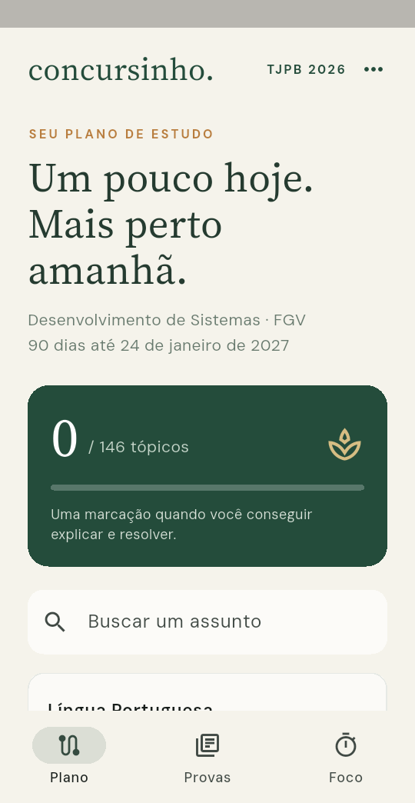
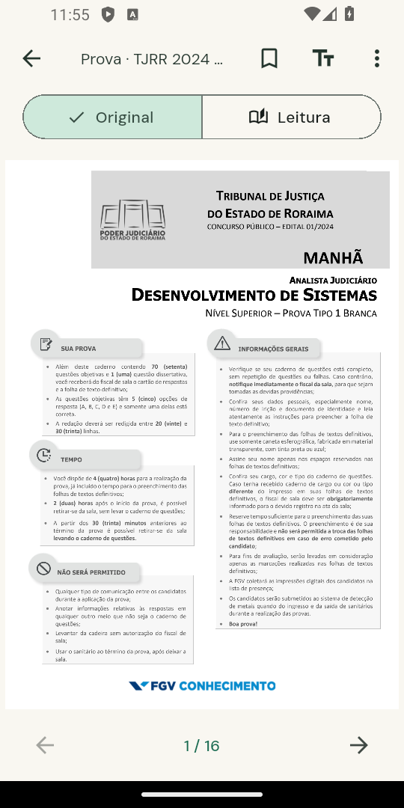
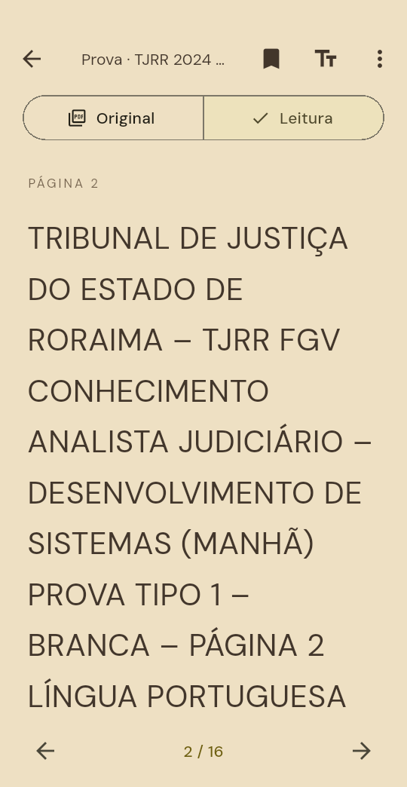

<p align="center">
  
</p>

<p align="center">
  <strong>Planeje o conteúdo. Leia com conforto. Volte amanhã.</strong><br>
  Um espaço pessoal de estudo com checklist, biblioteca de PDFs e Pomodoro.<br>
  Um repositório, com aplicativos para desktop e Android.
</p>

<p align="center">
  
  
  
  
</p>

<p align="center">
  <a href="#começar-no-desktop">Desktop</a> ·
  <a href="#usar-no-android">Android</a> ·
  <a href="#um-leitor-para-estudar">Leitor</a> ·
  <a href="#conteúdo-tjpb">TJPB</a> ·
  <a href="#desenvolvimento-e-testes">Desenvolvimento</a>
</p>

---

## Feito para manter o ritmo

O Concursinho reúne o próximo assunto, o material e o tempo de foco em um mesmo fluxo. No desktop, **Estudar agora** seleciona a disciplina recomendada, abre o próximo PDF e inicia o Pomodoro. No Android, o plano e o acervo acompanham você, inclusive sem internet.

| Recurso | Desktop | Android |
|:--|:--|:--|
| Checklist TJPB, busca e progresso | Sim, a partir da pasta de estudos | Incluído no aplicativo |
| Provas e gabaritos separados | PDFs na pasta configurada | Acervo incluído para uso offline |
| Leitura de PDF | Leitor associado ao sistema | Leitor nativo integrado |
| Fonte, tamanho e aparência | Conforme o leitor externo | Ajustáveis no modo Leitura |
| Foco e histórico | Pomodoro por disciplina | Pomodoro e minutos concluídos |
| Marcações TJPB | Arquivo JSON local | Importação e exportação de JSON |

## Por dentro do Android

<p align="center">
  
  &nbsp;
  
  &nbsp;
  
</p>

<p align="center"><sub>Capturas reais do aplicativo. Plano, página original e leitura adaptada.</sub></p>

### Um leitor para estudar

- **Original:** mantém a diagramação do PDF, com zoom e navegação por páginas.
- **Leitura:** transforma o texto extraído em uma página selecionável e ajustável.
- **Seu conforto:** três fontes locais, tamanho de 14 a 34, entrelinhas, margens e alinhamento.
- **Sua aparência:** fundos claro, sépia e noite, com suavização da luz.
- **Sua continuidade:** marcadores e retomada da última página de cada documento.
- **Seus materiais:** importação pelo seletor de arquivos do Android.

> A troca de fonte atua no modo **Leitura**. PDFs escaneados precisam de OCR para oferecer texto adaptável. A extração pode mudar a ordem das colunas; confira tabelas, código, figuras e alternativas em **Original**.

## Conteúdo TJPB

O acervo preparado em **26/10/2026** é voltado a Desenvolvimento de Sistemas:

| Plano | Prática | Referências |
|:--|:--|:--|
| **146 tópicos** em **14 blocos** | **9 provas** e **9 gabaritos definitivos** | Edital consolidado e primeira retificação |
| Busca, filtros e marcações | **2 espelhos de discursiva** | Fontes registradas no catálogo |

São **22 PDFs no Android**. Provas resolvidas e assuntos estudados têm marcações independentes. Os materiais antigos da Dataprev não fazem parte desse acervo.

No desktop, o checklist e os PDFs ficam na pasta de estudos, que pode estar no Obsidian. No Android, os dados e documentos acompanham o APK. A referência oficial do concurso continua sendo a [página da FGV](https://conhecimento.fgv.br/concursos/tjpb26).

## Começar no desktop

Requer **Python 3.10 ou superior**, Tk e as dependências de `requirements.txt`.

### 1. Preparar o ambiente

Clone uma única vez e mantenha essa pasta como sua cópia de trabalho:

```bash
git clone https://github.com/Scavuzzi/Concursinho.git
cd Concursinho
python -m venv .venv
```

No **Windows PowerShell**, instale e execute com o Python do ambiente:

```powershell
.\.venv\Scripts\python.exe -m pip install -r requirements.txt
Copy-Item .env.example .env
.\.venv\Scripts\python.exe main.py
```

No **Linux/macOS**:

```bash
source .venv/bin/activate
pip install -r requirements.txt
cp .env.example .env
python main.py
```

Depois de preparar o ambiente, o Windows também pode iniciar pelo arquivo **Abrir Concursinho.cmd**. No Linux, há o iniciador `run.sh`.

### 2. Apontar para seus materiais

Edite o `.env` criado no passo anterior ou use a aba **Configurações**. Os caminhos abaixo são exemplos; escolha as pastas existentes no seu computador:

```dotenv
CONCURSINHO_MATERIAIS_PATH=D:/MeuVault/Estudos/Concursinho/Materiais
CONCURSINHO_TJPB_PATH=D:/MeuVault/Estudos/TJPB 2026
```

A biblioteca geral usa **uma subpasta por disciplina**, com os PDFs dentro. Caminhos relativos são resolvidos a partir da pasta do aplicativo.

Para a aba TJPB, a pasta configurada deve conter o checklist, o índice e o catálogo já preparado:

```text
TJPB 2026/
├── 01 - Checklist completo - Desenvolvimento de Sistemas.md
├── 03 - Provas anteriores - Índice.md
├── Edital/
└── Provas anteriores/
    ├── manifesto_downloads.json
    └── pastas das provas e gabaritos
```

Se `CONCURSINHO_TJPB_PATH` for omitido, o app procura `TJPB 2026` como pasta irmã de `Concursinho`, a partir de `Concursinho/Materiais`. O clone do código não inclui o cofre pessoal do Obsidian; sem essa pasta externa, a aba informa quais materiais faltam.

### 3. Estudar

Use **TJPB 2026** para os tópicos e provas do concurso, ou **Estudo** e **Revisão** para sua biblioteca geral. O botão **Estudar agora** não interrompe uma sessão de foco em andamento. O histórico mantém a disciplina registrada no início do ciclo.

O campo **Comando PDF** aceita `auto`, que usa o programa padrão do sistema, ou um comando com `{file}`, como `zathura {file}`.

## Usar no Android

O aplicativo requer **Android 7.0/API 24 ou superior**. Para instalar uma cópia do APK, transfira o arquivo para o celular, abra-o e autorize a instalação pelo gerenciador de arquivos quando solicitado.

O leitor e o acervo funcionam offline. Os PDFs importados são copiados para o armazenamento privado do aplicativo. Não há conta nem sincronização pela nuvem.

Para gerar o APK a partir deste repositório, use Flutter **3.44/Dart 3.12** e o ambiente Android descrito em [mobile/README.md](mobile/README.md):

```bash
cd mobile
flutter pub get
flutter build apk --release
```

O resultado fica em `mobile/build/app/outputs/flutter-apk/app-release.apk`. O APK pessoal usa a assinatura local de desenvolvimento; preserve essa chave para produzir atualizações compatíveis. Não há publicação automática na Play Store.

## Progresso e privacidade

Os dados ficam no seu dispositivo. O desktop salva configurações, progresso e histórico em arquivos locais com gravação atômica e recuperação por `.bak`. O Android também mantém uma cópia de recuperação do estado.

Para transferir as **marcações TJPB**, use **Exportar marcações** e **Importar marcações** no Android. A lista JSON é compatível com `tjpb-progresso.json` do desktop. Para levar uma exportação ao computador, feche o app, guarde uma cópia do arquivo anterior e substitua-o pelo JSON exportado.

**A transferência é manual.** Ela não inclui PDFs importados nem preferências de leitura. As caixas das notas Markdown do Obsidian também não são sincronizadas com o progresso do app. Exporte suas marcações antes de desinstalar o Android.

O Pomodoro Android retoma pelo horário quando você volta ao app; esta versão **não toca alarme com o aplicativo suspenso ou fechado**.

## Organização do repositório

```text
Concursinho/
├── main.py                 # Aplicativo desktop e Pomodoro
├── tjpb.py                 # Catálogo e painel TJPB do desktop
├── test_main.py
├── test_tjpb.py
├── assets/readme/          # Capa e capturas desta documentação
├── mobile/
│   ├── lib/                # Plano, leitor e estado local
│   ├── assets/             # Catálogo, PDFs, fontes e licenças
│   ├── android/            # Configuração Android
│   ├── test/
│   ├── integration_test/
│   └── tools/export_tjpb.py
└── .env.example            # Exemplo; a configuração pessoal fica fora do Git
```

**Desktop e Android compartilham o repositório, cada um com seu ambiente de execução.** Mantenha uma única pasta de trabalho cadastrada no GitHub Desktop para evitar históricos locais divergentes. PDFs pessoais, `.env`, progresso, logs e ambientes virtuais ficam fora do versionamento; os PDFs públicos do acervo Android são assets explícitos.

## Desenvolvimento e testes

Desktop, na raiz:

```bash
python -m unittest -v test_main.py test_tjpb.py
```

Android, dentro de `mobile/`:

```bash
flutter analyze
flutter test
flutter drive --driver=test_driver/integration_test.dart --target=integration_test/app_test.dart -d <dispositivo>
```

O teste integrado usa um PDF real e verifica renderização nativa, extração de texto, aparência, navegação, marcadores e persistência. Consulte o [registro de validação do APK](mobile/VALIDACAO.md) e o [histórico de mudanças](CHANGELOG.md).

Para atualizar os assets Android a partir da pasta de estudos já preparada:

```bash
python mobile/tools/export_tjpb.py "CAMINHO/Estudos/TJPB 2026"
```

## Fontes e créditos

O leitor Android usa **Flutter**, **pdfrx** e **PDFium**. A interface traz **DM Sans**, **Source Serif** e **JetBrains Mono**, com suas licenças SIL OFL em [`mobile/assets/licenses`](mobile/assets/licenses).

A procedência dos materiais está em [`sources.json`](mobile/assets/data/sources.json): portais oficiais da FGV e cópias históricas TJPB/FAPERP do EstudeGrátis. As dependências mantêm suas próprias licenças, também disponíveis em **Sobre este acervo** no aplicativo.

---

<p align="center"><sub>Um assunto de cada vez. Uma sessão de cada vez.</sub></p>
